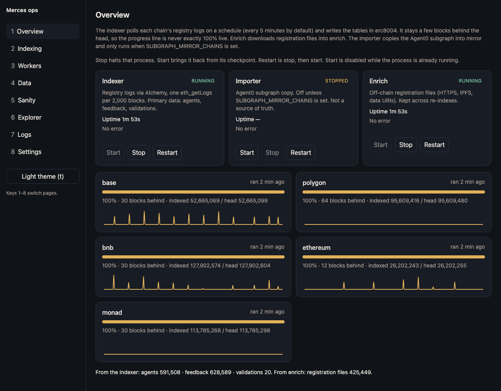

# ERC-8004 indexer

A self-hosted indexer for [ERC-8004 (Trustless Agents)](https://eips.ethereum.org/EIPS/eip-8004) with an operator dashboard. It reads the Identity, Reputation, and Validation registries on several EVM chains, downloads each agent's registration file, and serves the result from Postgres through a read-only schema that an app can query directly.

It powers the agent catalog of [Merces](https://merces.ai). The app lives in a separate repository and only ever sees schema `read`.



**What it does**

- Indexes every ERC-8004 registry event on Base, BNB Chain, Ethereum, Polygon, and Monad, and any other chain listed in `packages/shared/src/chains.ts`: agents, owners, URIs, wallets, metadata, feedback, responses, and validations.
- Fetches each agent's registration file over HTTPS, IPFS, or `data:` URIs, with SSRF protection, and explodes its `services` into rows.
- Exposes a stable, documented read model ([docs/app-data-contract.md](docs/app-data-contract.md)) to a read-only Postgres role.
- Checks itself: every 6 hours it compares a sample of rows against the chain, the Agent0 subgraph, and 8004scan.
- Runs as one Node process tree under systemd. No Docker, no Redis, no queue.

**Why it is built this way**

Most indexers follow the chain block by block. For a catalog that gains a few thousand events a day, that means paying an RPC provider to download hundreds of thousands of empty blocks. This indexer instead asks for the registries' logs every few minutes, one `eth_getLogs` per 2,000 blocks, and never downloads a block. Five chains cost about $1.50 a month in Alchemy compute units, and re-reading a chain's entire history costs cents. The price is freshness: data is about 5 minutes behind the chain, an hour for Monad.

**Quick start**

```bash
cp .env.example .env      # set DATABASE_URL, APP_RO_PASSWORD, ALCHEMY_API_KEY, CHAINS, START_BLOCK_<CHAIN>
pnpm install
pnpm db:init
pnpm ops                  # dashboard at http://127.0.0.1:42070
```

Node 22 or newer, pnpm 10.18, Postgres 16. Deploying to a server is in [DEPLOY.md](DEPLOY.md).

Do not treat schema `erc8004`, `mirror`, or `enrich` as an API. Those change when indexing changes. `read` is the stable surface.

## What is running

`pnpm ops` builds the dashboard, then starts one Node process: the supervisor (`packages/ops/src/supervisor.ts`). `pnpm start` starts that same process and does not rebuild the UI. Use `pnpm start` under systemd.

The supervisor starts and restarts these children:

| Child | Package | What it writes | Starts when |
| --- | --- | --- | --- |
| Indexer | `packages/indexer-erc8004` | `erc8004.*` from registry logs, every chain in one process | Always |
| Enrich worker | `packages/enrich-erc8004` | `enrich.*`, the JSON file behind each agent URI | Always |
| Subgraph importer | `packages/importer-subgraph` | `mirror.*`, a copy of the Agent0 subgraph for cross-checks | Only when `SUBGRAPH_MIRROR_CHAINS` names a chain. It can also be started from the dashboard |

The supervisor also serves the ops dashboard and, every `METRICS_INTERVAL_SEC` (default 15), writes a row to `ops.metrics_snapshots`. It makes no RPC calls for that; it reads the workers' health endpoints.

```text
RPC (Alchemy) ──► indexer ──► erc8004.* ──┐
                                           ├─► views in schema read ──► app_ro
HTTP / IPFS   ──► enrich  ──► enrich.* ───┘

The Graph     ──► importer ──► mirror.*     (optional, sanity only, app cannot see it)
supervisor    ──► ops.*                      (dashboard only, app cannot see it)
```

Ports, all bound to `127.0.0.1`:

| Port | Process |
| --- | --- |
| 42070 | Dashboard (`OPS_PORT`) |
| 42071 | Importer health |
| 42072 | Enrich health |
| 42073 | Indexer health: per-chain cursor, head, request and event counters |

## Schemas

Database `merces_data`. An agent is the pair `(chain_id, agent_id)`. There is no surrogate id. Addresses are lowercase `0x` plus 40 hex chars. Chain timestamps in `erc8004` are Unix seconds (`numeric`). Schema `read` converts those to `timestamptz`.

| Schema | What it is | Who writes | Who may read |
| --- | --- | --- | --- |
| `read` | Views. The app contract | Rebuilt by the supervisor when the view SQL changes | `app_ro` |
| `erc8004` | One table per entity for every chain: `agents`, `agent_metadata`, `feedback`, `feedback_responses`, `validations`. Plus `cursors` (per-chain progress) and `events` (the last 7 days of handled events, for the dashboard) | Indexer | Supervisor only. `app_ro` is denied |
| `enrich` | Fetched registration JSON and the `services` rows exploded out of it. Survives a re-index | Enrich worker | Through `read` only |
| `mirror` | Copy of the Agent0 subgraph. Can disagree with the chain and misses some later updates (see Known limits) | Importer, when enabled | Sanity only |
| `ops` | Dashboard logs, metric snapshots, sanity runs, worker pause flags, refetch jobs, `view_signature` | Supervisor | Dashboard only |

`read` views: `chains`, `agents`, `registration_files`, `services`, `feedback`, `feedback_responses`, `validations`, `agent_metadata`. Column lists, `uri_kind`, and `fetch_status` are specified in [docs/app-data-contract.md](docs/app-data-contract.md). If that file and `packages/ops/src/schemas.ts` disagree, the SQL in `schemas.ts` is what the database is running.

The views are rebuilt only when a hash of their SQL (stored in `ops.view_signature`) changes. Editing a view in `schemas.ts` is enough: the next supervisor start, `pnpm db:init`, or `pnpm verify:read` redeploys it. `app_ro` can `SELECT` from `read` and cannot `USAGE` the other schemas. `pnpm verify:read` checks that.

## The collectors

### Indexer

`packages/indexer-erc8004`. One process polls every chain in `CHAINS` on its own schedule:

| Setting | Default | Meaning |
| --- | --- | --- |
| `INDEX_INTERVAL_SEC` | 300 | Seconds between cycles for every chain |
| `INDEX_INTERVAL_SEC_<CHAIN>` | unset | Per-chain override. `.env.example` sets Monad to 3600 |
| `ETH_GET_LOGS_BLOCK_RANGE` | 2000 | Blocks per `eth_getLogs`. A range the provider rejects is halved and retried |
| `ALCHEMY_MAX_RPS` | 20 | Requests per second for the whole indexer, all chains together |

A cycle is one `eth_blockNumber`, then one `eth_getLogs` per 2,000 new blocks covering all three registries at once. Logs come back with `blockTimestamp`, which is the only block field the tables need, so the indexer never downloads a block or a transaction. A chain that is behind is caught up in the same way, four ranges in flight, applied strictly in block order.

The indexer stays a few blocks behind the head: 12 on Ethereum, 64 on Polygon, 240 on Arbitrum, 30 elsewhere (`confirmationsFor` in `packages/shared/src/chains.ts`). Logs inside that window are not read yet, so a reorg shallower than it never reaches the tables, and there is no reorg handling. Data in `read` is therefore up to one interval plus that window behind the chain: about 5 minutes for most chains, about an hour for Monad.

Each 2,000-block range is applied in one transaction together with its cursor in `erc8004.cursors`, so a crash never leaves half a range. Every write is an upsert, so replaying a range changes nothing. Events stored: `Registered`, `Transfer`, `URIUpdated`, `MetadataSet`, `NewFeedback`, `FeedbackRevoked`, `ResponseAppended`, `ValidationRequest`, `ValidationResponse`. `agents.feedback_count` and `last_feedback_at` count non-revoked feedback only; they are recomputed for every agent a range touches.

To read a chain again, for example after changing what a handler stores:

```bash
pnpm reindex --chain base                # delete that chain's erc8004 rows and start from its start block
pnpm reindex --chain base --from 4100000 # keep the rows and replay from that block
```

Both ask you to type `yes` in a terminal. The running indexer picks up the moved cursor on its next cycle. `enrich` is not touched. A full re-read is cheap: one `eth_getLogs` per 2,000 blocks, about 5,500 calls for all of Base's history.

Changing `START_BLOCK_<CHAIN>` after a chain has a cursor does nothing except log a warning. The cursor is the source of truth. Use `pnpm reindex` when you mean it.

### Enrich

`packages/enrich-erc8004/src/index.ts` and `fetchUri.ts`. A pass runs about once a minute and selects agents whose URI has no row, whose URI changed, or whose error retry is due. Each chain gets its own share: up to 200 `data:` URIs (decoded locally) and up to 40 network fetches, 500 agents per pass in total. Agents that share one URI are fetched once. `ipfs://` and the public gateway hosts (`ipfs.io`, `dweb.link`, `cloudflare-ipfs.com`, `nftstorage.link`, `w3s.link`, `4everland.io`, `gateway.pinata.cloud`) are fetched through `IPFS_GATEWAY`. Between passes the worker polls `ops.jobs` for `refetch_registration` jobs, which the Explorer page creates.

Private, loopback, and link-local addresses are refused, including decimal forms such as `http://2130706433/`. Only ports 80 and 443 are fetched. Redirects are checked again. A file that contains a NUL byte is stripped before insert. If one row still cannot be stored, that agent is marked and the pass continues.

`fetch_status` is `ok` or `error`. No row yet means not attempted. `unsupported uri scheme`, `invalid json`, `blocked address`, `unstorable content`, `HTTP 404`, and `HTTP 410` are not retried. Other errors wait 1 hour, then 6 hours, 1 day, then 7 days.

### Importer (optional)

`packages/importer-subgraph/src/index.ts`. Off by default. Set `SUBGRAPH_MIRROR_CHAINS` and, for each chain, `SUBGRAPH_ID_<CHAIN>` and `GRAPH_API_KEY`, then restart. It pages the Agent0 subgraph into `mirror.agents`, `mirror.registration_files`, `mirror.feedback`, `mirror.validations`, with cursors in `mirror.cursors`. Nothing in `read` or in sanity depends on it. Sanity's per-agent subgraph comparison queries The Graph directly whenever `SUBGRAPH_ID_<CHAIN>` is set.

## Dashboard

`http://127.0.0.1:42070`. No login. The page is for the operator, not for end users.

| Page | What it shows |
| --- | --- |
| Overview | One card per child process, and a progress line per chain from the latest metrics snapshot |
| Indexing | Lag, events/s, and RPC/s over time |
| Workers | Importer and enrich. Pause sleeps the loop and does not kill the process. The indexer can be paused through `POST /api/workers/indexer/pause` |
| Data | Counts, top owners, recent events (from `erc8004.events`, 7 days) |
| Explorer | Search agents. The chain dropdown is still Base only (see Known limits) |
| Sanity | Comparisons against RPC, the subgraph, and 8004scan. The supervisor runs one every 6 hours on its own (first run 6 hours after start) and stores it in `ops.sanity_runs`. The page can start one on demand |
| Logs | The in-memory ring since this supervisor started |
| Settings | Env values with secrets masked |

Stop, Start, and Restart on Overview control the OS process. Start is disabled while the status is `running` or `starting`. Restarting a child does not reload `.env`. After an `.env` edit, stop `pnpm ops` with Ctrl+C and start it again.

Buttons that change state send `POST` with header `x-merces-ops: 1`, and the server rejects a `Host` that is not `localhost` or `127.0.0.1`. A page on another website cannot submit those forms. Do not publish port 42070.

The progress line uses the latest row in `ops.metrics_snapshots`. Lag there is head minus the indexed block, and it is never zero: the indexer stays behind by design and only moves once per interval. If the supervisor is stopped, the page keeps showing the last row.

## Local setup

Postgres 16 is enough. The role must have `CREATEROLE` and must own the database.

```sql
CREATE ROLE merces LOGIN PASSWORD '...' CREATEROLE;
CREATE DATABASE merces_data OWNER merces;
```

```bash
cp .env.example .env
pnpm install
pnpm db:init
pnpm ops
```

`pnpm db:init` applies `sql/001_schemas_roles.sql`, `sql/002_app_read.sql`, and `sql/003_chain_tables.sql`, then builds the `read` views.

Fill at least: `DATABASE_URL`, `APP_RO_PASSWORD`, `ALCHEMY_API_KEY`, `CHAINS`, and `START_BLOCK_<CHAIN>` for each enabled chain. RPC URLs may contain `${ALCHEMY_API_KEY}`; the loader expands that. `loadEnv()` in `packages/shared/src/env.ts` overrides variables already in the shell, so a stale `export START_BLOCK_BASE=...` does not win. `MERCES_DOTENV=/path/to/other.env` makes every process read another file instead, for a test database.

The app connection string:

```text
postgres://app_ro:<APP_RO_PASSWORD>@127.0.0.1:5432/merces_data
```

Use the host and port from `DATABASE_URL`. A default Postgres install listens on `5432`.

### Upgrading from the Ponder version

Until October 2026 this repo indexed with [Ponder](https://ponder.sh): one process per chain, a schema `erc8004_<chain>` each, and Ponder's RPC cache in `ponder_sync`. A database from that time is moved once:

```bash
# stop pnpm ops first
pnpm migrate:ponder   # copies erc8004_<chain>.* into erc8004.*, resumes each chain from Ponder's checkpoint
pnpm ops
pnpm cleanup:ponder   # after checking the data: drops erc8004_<chain> and ponder_sync (asks for yes)
```

The migration downloads nothing. It converts `agent_metadata.value` from Ponder's hex text to the real bytes and recomputes `feedback_count` without revoked feedback.

## Add a chain

The chain key must already exist in `packages/shared/src/chains.ts` (`SPECS`). That file has the chain id, the env var names, the Identity deploy block, and the block explorer. Adding a chain the file does not know means a new `SPECS` row first.

```text
CHAINS=base,polygon,bnb,ethereum,scroll
START_BLOCK_SCROLL=29432417
RPC_SCROLL=https://...
```

Restart the supervisor. The new chain gets a cursor at `START_BLOCK - 1` and catches up from there. A full history is one `eth_getLogs` per 2,000 blocks. Its cost depends on how many blocks the chain has, not on how fast it makes them, so fast chains are as cheap to follow as slow ones.

`START_BLOCK_<CHAIN>` for a chain you want in full is the `identityDeployBlock` in `chains.ts`. A larger block permanently misses agents registered before it, except as stubs when a later event mentions them.

## Commands

| Command | Effect |
| --- | --- |
| `pnpm db:init` | Schemas, `app_ro`, chain tables, then `read` views |
| `pnpm block-at --chain base --days-ago 14` | Prints one block number. Does not edit `.env` |
| `pnpm ops` | Build the dashboard UI, then run the supervisor |
| `pnpm start` | Supervisor only. Use this in production |
| `pnpm ops:build` | `tsc` every package, then build the UI |
| `pnpm typecheck` | `tsc` every package, no UI build |
| `pnpm sanity` | One sanity run. Exit 1 if any check fails |
| `pnpm verify:read` | `app_ro` can read `read` and cannot read the other schemas |
| `pnpm reindex --chain base [--from N]` | Re-read one chain from the RPC, after you type `yes` |
| `pnpm migrate:ponder` | One-time move of a Ponder-era database |
| `pnpm cleanup:ponder` | Drop what Ponder left behind, after you type `yes` |

`pnpm sanity` compares a sample of agents and non-revoked feedback with the chain at the indexed block, with the subgraph when one is configured, and with 8004scan. Chain mismatches fail. Subgraph and 8004scan count gaps warn. A transport error against Alchemy is a failed chain check even when the row is fine, so one blip fails the run.

## Repository layout

```text
packages/shared            chains, env, Postgres pool, RPC, subgraph client, ABIs, secret redaction
packages/indexer-erc8004   scheduled registry-log indexer for every chain
packages/importer-subgraph Agent0 mirror (optional)
packages/enrich-erc8004    registration-file fetch
packages/ops               supervisor, HTTP API, React dashboard
sql/001_schemas_roles.sql  schemas, app_ro, enrich and mirror and ops tables
sql/002_app_read.sql       grants: app_ro reads `read` only
sql/003_chain_tables.sql   erc8004 tables and cursors
scripts/                   db-init, block-at, reindex, verify-read, migrate-from-ponder, cleanup-ponder
docs/app-data-contract.md  the only API the app should use
```

Importing `@merces/shared` calls `loadEnv()`. Scripts import the package source with a relative path and run under `tsx`.

viem 2.57.2 and hono 4.13.13 are pinned exactly. `pnpm typecheck` must stay green.

## Production

Short version: OS user `merces`, `/opt/merces-data`, `ExecStart=/usr/bin/pnpm start`, dashboard only through `ssh -L 42070:127.0.0.1:42070`. Back up the whole database nightly; after the Ponder cleanup it is a few GB. The step-by-step, including creating the OS user, is [DEPLOY.md](DEPLOY.md).

## RPC cost

Alchemy bills compute units: 10 for `eth_blockNumber`, 60 for `eth_getLogs`, 20 for a block. Pay-as-you-go is about $0.45 per million. With the defaults:

| Work | Requests per month | Compute units per month |
| --- | --- | --- |
| Base, BNB, Ethereum, Polygon every 5 minutes | about 35,000 | about 2.4M |
| Monad every hour | about 5,000 | about 0.3M |
| Sanity every 6 hours, 5 chains | about 25,000 | about 0.7M |

That is about 3.4M units, roughly $1.50 a month. Measured on 15 Oct 2026: re-reading Ethereum's full history took 938 requests, and catching Monad up through 5.3 million blocks took 2,660. A full re-read of every chain's history is about 70,000 `eth_getLogs`, about 4M units. Ponder, which this replaced, downloaded every block of every chain and cost about $110 a month for four chains, and about $400 with Monad.

## Known limits

These are real. A new agent should not "fix" them by dropping schemas.

- **Reorgs deeper than the confirmation window are not undone.** The indexer stays 12 to 240 blocks behind the head and never rewrites applied ranges. A deeper reorg would leave a stale row until `pnpm reindex --from` replays it. Sanity's chain comparison would show it as a mismatch.
- **Strings from the chain lose NUL characters.** Postgres text cannot store them. An agent URI that contains one differs from `tokenURI` by that character, and sanity reports it.
- **`erc8004.events` keeps 7 days.** It is for the dashboard. The tables are rebuilt from the RPC, not from it.
- **Explorer dropdown is Base only** (`packages/ops/ui/src/pages/ExplorerPage.tsx`). The API accepts other chain ids.
- **Overview progress is the last snapshot.** A stopped supervisor still shows the last numbers until a new process writes a snapshot.
- **The indexer has no pause button.** Use `POST /api/workers/indexer/pause` or Stop on Overview.
- **Mirror incremental sync can skip rows** that share a timestamp at a 1,000-row page boundary, and it does not re-read a feedback row when it is later revoked (`createdAt` does not change). Fine for a coarse count check. Not fine as a source of truth. It only matters when the importer is enabled.
- **A terminal enrich error is sticky across a URI change.** If the old URI was `HTTP 404` or `invalid json`, a newer on-chain URI is not fetched until that rule is narrowed.
- **Pinata's public gateway returns HTTP 429** under load. IPFS files retry on the long ladder (1h, 6h, 1d, 7d). A keyed gateway in `IPFS_GATEWAY` is the durable fix.
- **Service rows for one agent are written as several autocommits.** A crash between the delete and the inserts can leave `fetch_status = ok` and an empty service list.
- **`ops.logs` is not what the Logs page shows.** The page is the in-memory ring since this process started. The table is kept for 3 days and is not read back after a restart.
- **There is no automated test suite.** `pnpm typecheck` is the check that runs in this repo.

## Rules for the next change

1. Read [docs/app-data-contract.md](docs/app-data-contract.md) before changing anything the app selects.
2. Do not point the app at `erc8004`, `mirror`, `enrich`, or `ops`.
3. A change to what the indexer stores is applied to old rows only by `pnpm reindex`. Plan for that, it is cheap.
4. One Alchemy key is shared by the indexer, sanity, and `block-at`. `ALCHEMY_MAX_RPS` caps the indexer only.
